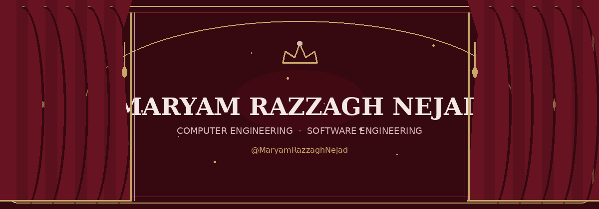

<!-- ROYAL CHERRY | Profile README for @MaryamRazzaghNejad -->

  
  
A slow, seamless 24-second performance: the curtains open fully, pause, and close again in a continuous loop.

  <h1>Maryam Razzagh Nejad</h1>
  
<strong>Computer Engineering Student · Aspiring Software Engineer</strong>

  
<em>Building from fundamentals. Designing with intention. Growing toward intelligent systems.</em>

  
 

  

## ❦ About Me

I’m **Maryam**, an undergraduate **Computer Engineering** student building a practical foundation in software development and the principles behind reliable, maintainable systems. I’m especially interested in the relationship between strong computer-science fundamentals, thoughtful interface design, and the engineering decisions that make software useful at scale.

My current strengths are **HTML, CSS, and web-template design**. I have previously studied and practiced **Dart**, explored **Python**, and am currently completing **JavaScript fundamentals**. I use GitHub to keep learning work visible, document exercises, and turn concepts into progressively more substantial projects.

My longer-term direction is **full-stack software engineering**, followed by deeper study in **Artificial Intelligence and Machine Learning**. I intend to approach that path deliberately: deepen one foundation at a time, build real applications, and understand the systems behind the tools I use.

- 🎓 **Education:** Undergraduate Computer Engineering student
- ✦ **Current strengths:** HTML, CSS, responsive-layout concepts, and web-template design
- ✧ **Current focus:** Completing JavaScript fundamentals
- ❧ **Previous learning:** Dart (with practice repositories) and Python
- ♛ **Long-term direction:** Software Engineering → AI Engineering

## ❧ Engineering Philosophy

> Elegant software is not merely code that works. It is a system whose structure, behaviour, and purpose are understood.

I value fundamentals over shortcuts, deliberate practice over superficial familiarity, and projects that demonstrate how concepts work together.

## ✦ Languages & Experience

The levels below describe the learning history shared so far; they are not proficiency scores.

| Technology | Current stage | Evidence / next step |
|:--|:--|:--|
| **HTML5** | Comfortable foundation | Used for page structure and web-template work; continue building accessible, semantic interfaces. |
| **CSS3** | Comfortable foundation | Used for styling, layouts, and template design; continue strengthening responsive and maintainable styling. |
| **JavaScript** | Fundamentals in progress | Completing beginner-level study; next milestone is deeper language concepts and practical browser projects. |
| **Dart** | Previously studied & practiced | Dart exercises and learning repositories; revisit through a structured Flutter project when appropriate. |
| **Python** | Previously studied | Earlier study provides an initial foundation; refresh the language before backend or machine-learning work. |

## ♜ Tools & Working Environment

Git and GitHub are part of my learning workflow. I have also worked with VS Code and explored Linux and Docker-based development environments; the depth of experience varies by tool.

## ♛ Learning Roadmap

This roadmap reflects intended next steps, not claims of current proficiency.

| Stage | Focus | Status |
|:--:|:--|:--|
| **01** | Finish JavaScript fundamentals, then advance to modern JavaScript | **In progress** |
| **02** | React → Next.js → TypeScript | Planned |
| **03** | Node.js and API development | Planned |
| **04** | Databases, SQL, and data modelling | Planned |
| **05** | Django / Python backend development | Planned |
| **06** | Flutter and cross-platform application development | Planned |
| **07** | Mathematics for ML, machine learning, deep learning, and AI engineering | Long-term direction |

I’m keeping the sequence intentional: JavaScript first, then modern frontend and backend development, with databases and Python-based backend work added as the foundations mature. AI specialization comes after strengthening programming, mathematics, and practical engineering skills.

## ❧ Skill Matrix

| Area | Current relationship |
|:--|:--|
| Web foundations | **HTML / CSS — current strengths** |
| Programming | **JavaScript — actively learning** |
| Previous language practice | **Dart — studied and practiced; Python — previously studied** |
| Frontend frameworks | React, Next.js — planned |
| Backend | Node.js, Django — planned |
| Mobile | Flutter — planned |
| Data | SQL and database design — planned |
| AI / ML | Future specialization |

## ❦ Projects & Practice

I use my repositories as a record of learning, experimentation, and implementation. My public work includes **Dart practice and exercises**. I’m developing my project portfolio over time and will feature selected projects here when they are ready to present with a clear scope, technology list, and source-code link.

## ♛ GitHub Activity

  
  

### 🐍 Royal Cherry Contribution Snake

  <picture>
    <source media="(prefers-color-scheme: dark)" srcset="https://raw.githubusercontent.com/MaryamRazzaghNejad/MaryamRazzaghNejad/output/github-snake-dark.svg" />
    <source media="(prefers-color-scheme: light)" srcset="https://raw.githubusercontent.com/MaryamRazzaghNejad/MaryamRazzaghNejad/output/github-snake.svg" />
    
  </picture>

## ✧ Current Focus

- Finish JavaScript fundamentals with consistent coding practice.
- Turn HTML, CSS, and JavaScript knowledge into complete frontend projects.
- Keep exercises and project work documented in GitHub.
- Build toward React, Next.js, Node.js, databases, and Python backend development in a focused sequence.

## ♛ Beyond the README — Interactive Curtain Experience

GitHub README rendering does not provide arbitrary JavaScript or reliable hover-triggered interaction. The animated GIF above is the compatible profile header. A separate interactive curtain page is included in [`docs/index.html`](./docs/index.html); after enabling GitHub Pages from the `/docs` folder, it can be visited at `https://maryamrazzaghnejad.github.io/MaryamRazzaghNejad/`.

## ✦ Connect

  
  <!-- Replace these placeholders with your actual public profile URLs. -->
  
  
  

  
  
<strong><em>Learn deeply. Build with intention. Engineer responsibly.</em></strong>

  <a href="./SECURITY-REVIEW.md">Security and privacy notes</a>
  Thank you for visiting the Royal Cherry atelier.

